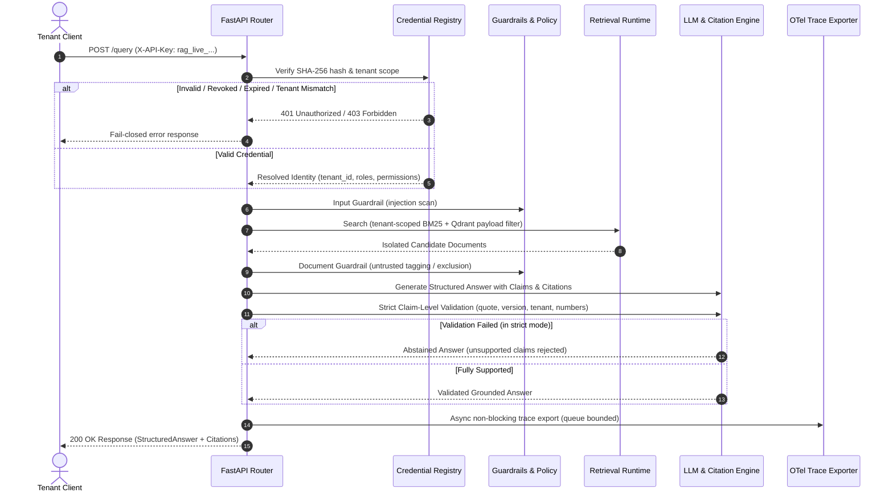
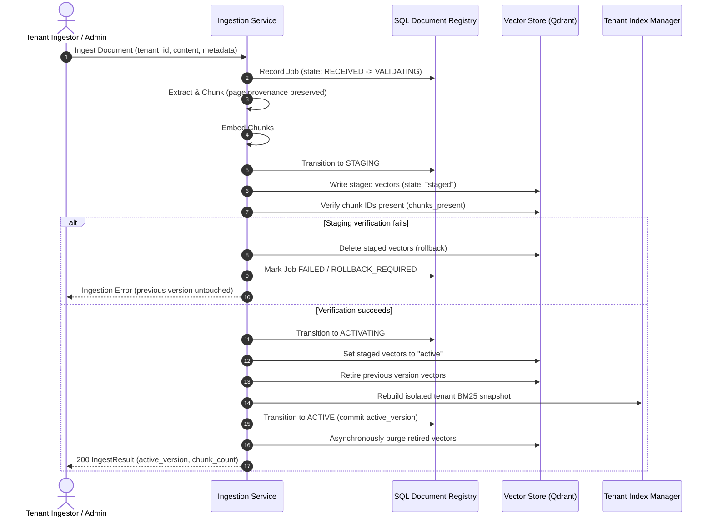

# ⚡ Production RAG Evaluation & Observability Platform (LangGraph & LangChain)

A RAG (Retrieval-Augmented Generation) evaluation project powered natively by **LangChain** and **LangGraph**, built to empirically prove that **retrieval quality and hallucination detection — not just retrieval itself — are the core challenge in RAG**.

Equipped with an OpenTelemetry tracing harness (`gen_ai.*` semantic conventions), deterministic retrieval metrics (Recall@K, Precision@K, MRR, nDCG), LLM-as-Judge groundedness evaluation, automated regression CI quality gates, and a Next.js analytics dashboard.

---

## 🛠️ Tech Stack

| Category | Technologies & Libraries |
| :--- | :--- |
| **Orchestration & AI** |    |
| **LLMs & Embeddings** |   |
| **Retrieval & Reranking** |    |
| **Backend & Observability** |    |
| **Analytics Dashboard** |     |
| **Infra & Quality Gates** |    |

---

## 🏛️ LangGraph StateGraph Architecture

```
 ┌────────────────────────────────────────────────────────────────────────┐
 │                              User Request                              │
 └───────────────────────────────────┬────────────────────────────────────┘
                                     │
                                     ▼
 ┌────────────────────────────────────────────────────────────────────────┐
 │                LangGraph StateGraph Workflow (compile_rag_graph)       │
 ├───────────────────┬───────────────────┬────────────────────────────────┤
 │ 1. retrieve_node  │ 2. rerank_node    │ 3. generate_node               │
 │ (EnsembleRetriever│ (ContextualCompr. │ (ChatPromptTemplate +          │
 │  Dense + BM25)    │  CrossEncoder)    │  ChatGoogleGenerativeAI)       │
 └─────────┬─────────┴─────────┬─────────┴─────────┬──────────────────────┘
           │                   │                   │
           ▼                   ▼                   ▼
 ┌────────────────────────────────────────────────────────────────────────┐
 │                    OpenTelemetry Tracing Layer                        │
 │  - GenAI Semantic Conventions                                          │
 │  - Latency per stage (ms) | Token usage | Cost calculation ($ USD)     │
 └───────────────────────────────────┬────────────────────────────────────┘
                                     │
                                     ▼
 ┌────────────────────────────────────────────────────────────────────────┐
 │                   Next.js + Recharts Dashboard                         │
 │     - Trace Explorer (per-stage breakdown & total cost)                │
 │     - Eval Trends (Recall@K, MRR, Faithfulness over runs)               │
 └────────────────────────────────────────────────────────────────────────┘
```

---

## 🔒 Iteration 2 Architecture & Security Hardening

Iteration 2 transitions the platform from a prototype to a multi-tenant, operationally hardened system featuring cryptographic tenant credentials, tenant-isolated sparse retrieval, strict claim-level citation validation, retrieved-evidence prompt injection defense, and transactional 9-state document staging.

### 1. Multi-Tenant Authenticated Request Sequence



### 2. Transactional Document Ingestion & Safe Activation



---

## 🔗 LangChain & LangGraph Ecosystem Integration

- **Document Loaders**: `langchain_community.document_loaders` (`TextLoader`, `PyPDFLoader`, `BSHTMLLoader`)
- **Text Splitters**: `langchain_text_splitters` (`RecursiveCharacterTextSplitter`, `CharacterTextSplitter`)
- **Embeddings**: `langchain_google_genai.GoogleGenerativeAIEmbeddings` (model: `models/gemini-embedding-001`)
- **Vector Storage**: `langchain_qdrant` (`QdrantVectorStore` with `InMemoryVectorStore` fallback)
- **Hybrid Retrievers**: Explicit full-corpus BM25Okapi and dense retrieval combined by weighted reciprocal rank fusion
- **Rerankers**: LangChain `ContextualCompressionRetriever` with Cross-Encoder compression
- **Prompts**: `langchain_core.prompts.ChatPromptTemplate`
- **LLM Models**: `langchain_google_genai.ChatGoogleGenerativeAI` (model: `gemini-2.5-flash`)
- **Orchestration**: LangGraph `StateGraph` (`src/pipeline/graph.py`)

---

## 📁 Project Structure

```text
RAG-Quality-Harness/
├── src/                          # Core backend and RAG engine
│   ├── api/                      # FastAPI REST application
│   │   └── main.py               # API endpoints, Swagger docs, health checks
│   ├── evaluation/               # Evaluation & quality gate regression framework
│   │   ├── golden_dataset.py     # Evaluation dataset loader & validation
│   │   ├── judge.py              # LLM-as-a-Judge evaluation engine
│   │   ├── judge_prompts.py      # Structured evaluation & groundedness prompts
│   │   ├── regression_runner.py  # CI/CD regression test runner & threshold gates
│   │   └── retrieval_metrics.py  # Deterministic IR metrics (Recall@K, MRR, nDCG)
│   ├── generation/               # LLM generation & synthesis
│   │   ├── generator.py          # ChatGoogleGenerativeAI invocation & responses
│   │   └── prompt_builder.py     # ChatPromptTemplate assembly & context formatting
│   ├── guardrails/               # Safety & hallucination detection guardrails
│   │   ├── detector.py           # Real-time hallucination & groundedness detector
│   │   └── regex_patterns.py     # PII & prompt injection pattern matching
│   ├── ingestion/                # Document processing pipeline
│   │   ├── chunker.py            # LangChain text splitters (recursive character)
│   │   ├── embedder.py           # Embeddings generator (Google Generative AI)
│   │   └── loaders.py            # Document loaders (PDF, HTML, text)
│   ├── pipeline/                 # Pipeline orchestration
│   │   └── graph.py              # LangGraph StateGraph workflow definition
│   ├── retrieval/                # Multi-stage retrieval system
│   │   ├── reranker.py           # ContextualCompressionRetriever & Cross-Encoder
│   │   ├── retriever.py          # Hybrid EnsembleRetriever (Dense + BM25)
│   │   └── vector_store.py       # Qdrant vector database connector & fallback
│   ├── tracing/                  # OpenTelemetry observability & telemetry
│   │   ├── cost.py               # Token usage & per-query USD cost tracking
│   │   ├── exporter.py           # OTel spans exporter & SQLite trace persistence
│   │   └── tracer.py             # GenAI semantic conventions instrumentation
│   └── config.py                 # Central configuration (Pydantic Settings)
├── dashboard/                    # Next.js 14 Analytics Dashboard
│   └── src/app/                  # App Router pages
│       ├── evals/                # Evaluation trends, regression diffs & charts
│       ├── traces/               # OpenTelemetry trace explorer & span details
│       ├── layout.tsx            # Global dashboard layout & navigation
│       └── page.tsx              # Analytics overview & system health
├── data/                         # Knowledge base documents
│   └── sample_docs/              # Markdown & text documents for indexing
├── eval/                         # Evaluation artifacts & benchmarks
│   └── golden_dataset.jsonl      # Curated ground-truth Q&A evaluation pairs
├── infra/                        # Infrastructure & deployment configuration
│   ├── docker-compose.yml        # Qdrant + Postgres + API stack
│   ├── docker-compose.full.yml   # Adds Next.js dashboard service
│   ├── Dockerfile.api            # FastAPI backend image (fail-closed healthcheck)
│   ├── Dockerfile.dashboard      # Next.js dashboard image
│   └── init.sql                  # PostgreSQL trace & eval database schema
├── tests/                        # Automated test suite
│   └── unit/                     # Unit test modules (Pytest)
│       ├── test_chunker.py       # Chunking & splitting tests
│       ├── test_citations_context.py   # Citation & context validation tests
│       ├── test_evaluation_extensions.py   # Evaluation schema v3 extensions
│       ├── test_evaluation_reliability.py   # Regression/failure/math/API validation
│       ├── test_guardrails.py    # Guardrail & detector unit tests
│       ├── test_ingestion_service.py   # Ingestion versioning/rollback/deletion
│       ├── test_index_manager.py   # Index lifecycle/concurrency tests
│       ├── test_judge.py         # LLM judge logic tests
│       ├── test_metrics.py       # IR retrieval metrics math tests
│       ├── test_metrics_exporter.py   # Trace exporter tests
│       ├── test_pipeline_graph.py   # Pipeline graph tests
│       ├── test_runtime_models.py   # Model lifecycle/readiness tests
│       └── test_security_api.py   # Security/API tests
├── .env.example                  # Template for required environment variables
├── pytest.ini                    # Pytest configuration
├── requirements.txt              # Production & development Python dependencies
├── requirements-offline.txt      # Pinned offline dependencies (Python 3.14)
└── README.md                     # Project documentation
```

---

## 🎯 WORKED EXAMPLE: Catching a Retrieval & Groundedness Regression

The historical worked-example scores (90% Recall@5, MRR 0.95, faithfulness 0.95) and the 65% to 90% resume claim are **unverified**. They were not produced by a reproducible run of the original harness and must not be cited as measured results.

See [EVALUATION_REPORT.md](EVALUATION_REPORT.md) for executed tests and actual results, and [eval/METHODOLOGY.md](eval/METHODOLOGY.md) for provenance, exact metrics, commands and limitations.

## Quick Start Guide

### 1. Installation & Environment Setup
```bash
python -m venv .venv
# Windows:
.venv\Scripts\activate
# Linux/macOS:
source .venv/bin/activate

pip install -r requirements.txt
```

### 2. Configure Environment Variables (Gemini / Google API Key)
Create `.env` file in root:
```env
LLM_PROVIDER=gemini
GEMINI_API_KEY=your_gemini_api_key_here
GEMINI_MODEL=gemini-2.5-flash
EMBEDDING_MODEL=models/gemini-embedding-001
```

### 3. Run API Server
```bash
uvicorn src.api.main:app --reload --port 8000
```
Interactive Swagger Docs: [http://localhost:8000/docs](http://localhost:8000/docs)

### 4. Run Evaluation Suite
```bash
python -m src.evaluation.regression_runner
```

### 5. Run Dashboard
```bash
cd dashboard
npm install
npm run dev
```
Dashboard URL: [http://localhost:3000](http://localhost:3000)


## Reproducible retrieval regression

Offline tests need no credentials or model downloads:

```bash
pip install -r requirements-offline.txt  # Python 3.14; runtime application dependencies remain in requirements.txt
python -m pytest -q
python -m src.evaluation.regression_runner --dataset eval/fixtures/queries.jsonl --corpus eval/fixtures/corpus --mode hybrid --min-recall 0.9
```

Repeat with `--mode dense` and `--mode bm25` to compare configurations. `--mode hybrid-rerank --backend local` uses the real cross-encoder and local semantic embeddings; model weights must be available. `--backend google --judge` explicitly enables paid embeddings, generation and judge evaluation. Offline hash embeddings are a deterministic lexical fixture, not a semantic quality benchmark.

Retrieval evaluation creates a fresh isolated in-memory store and indexes every corpus document once. The graph accepts an explicit vector store and corpus through `compile_rag_graph(vector_store=..., corpus_documents=...)`. The API shares its process-local default store for ingestion/query fallback; BM25 reads the entire indexed collection rather than previous result state, and reranking compresses existing candidates. Qdrant collections with legacy/missing chunk IDs require reingestion. Default collection reads are not an atomic snapshot during concurrent production ingestion.

Offline CI executes unit tests and three retrieval configurations on 28 explicitly synthetic queries over 16 fixture documents. The inherited 10-query sample is preserved with unverified annotation provenance. Missing judge credentials produce an unavailable status and CLI exit 2; skipped scores stay absent rather than being presented as zero or invented dashboard numbers. Reports contain SHA-256 fingerprints, configuration, installed versions, per-query errors/misses and p50/p95 stage timings. Baselines are created only with `--accept-baseline` and compared only with explicit `--baseline`.

Runtime defaults: Google `models/gemini-embedding-001`, Gemini `gemini-2.5-flash`, local fallback `BAAI/bge-small-en-v1.5`, reranker `BAAI/bge-reranker-base`. These are configured model identifiers, not assertions about provider availability. Cloud/local results and exact billing measurements have not been verified in this repair. See the methodology for supported resume statements and known limitations.

## CI/CD workflows

Normal CI is deterministic and offline (no paid LLM APIs, no network, no credentials). Separate opt-in workflows handle live evaluation and performance:

| Workflow | Trigger | Purpose |
|---|---|---|
| `.github/workflows/ci.yml` | push / PR | Offline unit tests, compileall, pip check |
| `.github/workflows/retrieval.yml` | push / PR | Dense / BM25 / hybrid / diagnostic regression gates |
| `.github/workflows/security.yml` | push / PR | Security/API test suite; rejects live credentials in tests |
| `.github/workflows/frontend.yml` | push / PR (dashboard paths) | `npm ci`, `tsc --noEmit`, `npm run build` |
| `.github/workflows/performance.yml` | schedule / dispatch | Retrieval benchmarks at concurrency 1/5/10 (10k chunks) |
| `.github/workflows/live-evaluation.yml` | manual dispatch | Opt-in live embeddings/generation/judge (requires `GEMINI_API_KEY` secret) |

A missing baseline, missing credentials, failed benchmark, or unavailable model must not be reported as a successful evaluation.

## Dashboard pages

| Page | Path | Data source |
|---|---|---|
| Overview | `/` | `/ready`, `/runtime/status`, `/traces`, `/evals/reports` |
| Trace Waterfall | `/traces` | `/traces`, `/traces/{query_id}` |
| Eval Benchmarks | `/evals` | `/evals/reports` + CLI command snippet |
| Ingest Studio | `/ingest` | `/ingest`, `/runtime/status` |
| Runtime & Index | `/runtime` | `/ready`, `/runtime/status`, `/documents`, `/index/refresh` |
| RAG Playground | `/playground` | `/query` |

Every dashboard value originates from persisted telemetry or evaluation data; unavailable values are shown as unavailable, never as zero or success.

## Docker

The API image carries a fail-closed `/ready` healthcheck. `LLM_PROVIDER` defaults to `gemini` (never `mock`). Use `docker-compose.yml` for the API stack (Qdrant + Postgres + API) or `docker-compose.full.yml` to also run the Next.js dashboard. Set `LLM_PROVIDER`, `GEMINI_API_KEY`, `MODEL_INIT_MODE`, `RERANK_POLICY`, `STORE_BACKEND`, and `APP_ENV` via environment; an `.env` is not committed.

