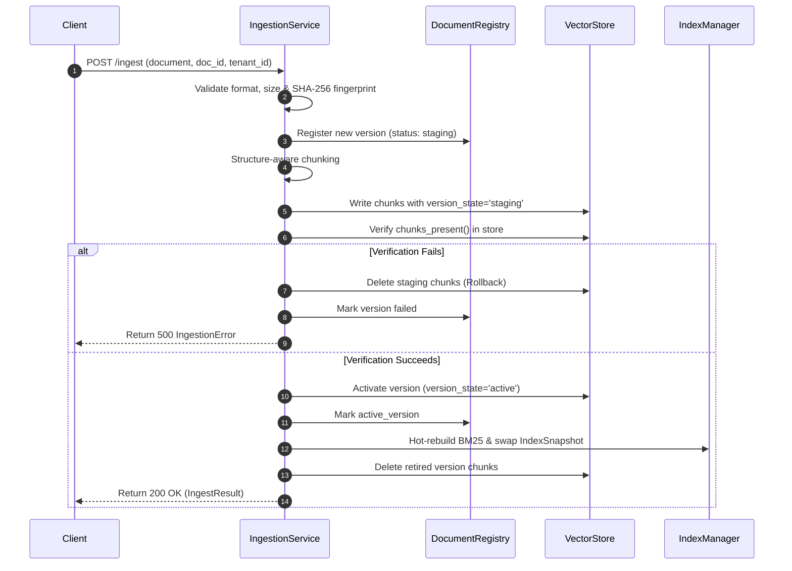
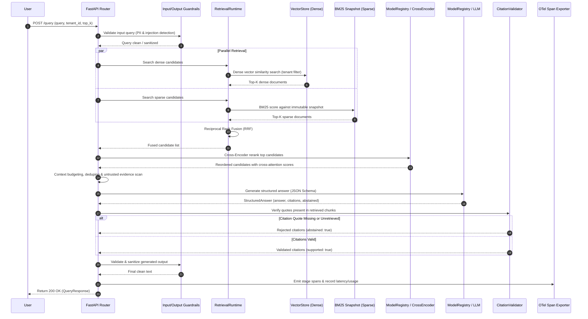

# Architecture Overview

## System Boundaries

```
┌─────────────────────────────────────────────────────────────────────┐
│                         RAG Platform                                 │
├─────────────────┬─────────────────┬─────────────────┬───────────────┤
│   Ingestion     │   Retrieval     │   Generation    │  Evaluation   │
│  (Service)      │  (Runtime)      │  (Pipeline)     │  (Platform)   │
├─────────────────┼─────────────────┼─────────────────┼───────────────┤
│ • Loaders       │ • Dense         │ • Context       │ • Datasets    │
│ • Normalizer    │   Retriever     │   Builder       │ • Retrieval   │
│ • Fingerprint   │ • Sparse        │ • Generator     │   Metrics     │
│ • Chunker       │   (BM25)        │ • Citations     │ • Answer      │
│ • Embedder      │ • Fusion (RRF)  │ • Guardrails    │   Metrics     │
│ • Versioning    │ • Reranker      │ • Structured    │ • Judge       │
│ • Activation    │ • Index Manager │   Output        │ • Regression  │
└────────┬────────┴────────┬────────┴────────┬────────┴──────┬───────┘
         │                 │                 │               │
         └─────────────────┼─────────────────┘               │
                           ▼                                 │
              ┌─────────────────────────┐                    │
              │     Vector Store        │                    │
              │  (InMemory / Qdrant)    │                    │
              └─────────────────────────┘                    │
                           │                                 │
                           ▼                                 ▼
              ┌─────────────────────────┐           ┌─────────────────┐
              │     Telemetry           │           │   Evaluation    │
              │  (OTel + SQLite/Postgres)           │   Reports       │
              └─────────────────────────┘           └─────────────────┘
                           │
                           ▼
              ┌─────────────────────────┐
              │      API / Dashboard    │
              │   (FastAPI + Next.js)   │
              └─────────────────────────┘
```

## Core Components

### Ingestion Service (`src/ingestion/ingestion_service.py`)
- Validates, normalizes, fingerprints, chunks, embeds documents.
- Staging → verification → activation → registry → index rebuild → retired deletion.
- Idempotent by content SHA-256; stable document/chunk IDs.

### Retrieval Runtime (`src/retrieval/retrieval_runtime.py`, `src/retrieval/index_manager.py`)
- Versioned immutable `IndexSnapshot` (chunks, vectors, BM25 index, corpus fingerprint).
- `BM25Retriever` built once per snapshot; reused across queries.
- Dense retrieval via vector store cosine similarity.
- Hybrid via weighted RRF (configurable weights, RRF constant).
- Reranking compresses existing candidates (no second search).
- Explicit `/index/refresh` for manual rebuild; automatic on ingestion activation.

### Generation Pipeline (`src/pipeline/graph.py` - LangGraph StateGraph)
1. `retrieve_node`: hybrid retrieval (dense + BM25 + RRF).
2. `rerank_node`: cross-encoder reranking (optional, lifecycle-managed).
3. `generate_node`: grounded synthesis with structured output.
4. `validate_citations_node`: citation existence + quote verification.
5. `guardrails_node`: PII, injection detection, output sanitization.

### Evaluation Platform (`src/evaluation/`)
- Synthetic regression (28 queries, 16 docs) + human-annotated template.
- Retrieval metrics, answer metrics, LLM judge, statistical tests.
- Schema v3 reports: manifest, CI, per-category, unanswerable, judge provenance.
- Immutable baselines; fail-closed comparison.

### Observability (`src/tracing/`, `src/runtime/metrics.py`)
- OTel spans per pipeline stage (gen_ai.* conventions).
- Bounded async SQLite/Postgres exporter; dropped/failed counters.
- Prometheus metrics: latency, errors, queue depth, token usage (estimated).

### API (`src/api/main.py`)
- REST endpoints: `/ingest`, `/ingest/file`, `/documents`, `/documents/{id}`, `/query`, `/index/refresh`, `/ready`, `/runtime/status`, `/traces`, `/evals/reports`, `/evals/run`.
- Role-based auth (`ingestor`/`reader`/`admin`).
- Structured errors with request IDs.

### Dashboard (Next.js 14, `dashboard/src/app/`)
- `/` Overview: real telemetry, eval reports, runtime status.
- `/runtime` Live: readiness, index, telemetry, config, documents, refresh/delete.
- `/evals` Benchmarks: historical runs, trends, CI command.
- `/ingest` Studio: text/file ingestion, live index specs.
- `/traces` Waterfall: per-query span timeline.
- `/playground` Query sandbox.

## Data Flow

```mermaid
flowchart TD
    subgraph Ingestion ["Ingestion Subsystem"]
        A["Document Upload"] --> B["Validation & Normalization"]
        B --> C["Structure-Aware Chunking"]
        C --> D["Embedding Generation"]
        D --> E["Staging Write & Verification"]
        E --> F["Atomic Version Activation"]
        F --> G["Index Rebuild & Hot-Swap"]
    end

    subgraph QueryPath ["Query Execution Path"]
        Q["User Query"] --> IG["Input Guardrail"]
        IG --> DR["Dense Retrieval"]
        IG --> SR["Sparse Retrieval (BM25)"]
        DR --> FUS["Reciprocal Rank Fusion (RRF)"]
        SR --> FUS
        FUS --> RR["Cross-Encoder Reranker"]
        RR --> CTX["Token-Budgeted Context Assembly"]
        CTX --> LLM["Structured LLM Generation"]
        LLM --> CV["Citation Validation Layer"]
        CV --> OG["Output Guardrail"]
        OG --> RESP["Structured Validated Response"]
    end
```



## Sequence Diagrams

### Document Ingestion & Safe Activation Lifecycle



### Grounded Query Execution & Evidence Validation




## Configuration

All settings via `src/config.py` (Pydantic Settings, env file `.env`):
- Model lifecycle: `MODEL_INIT_MODE`, `RERANK_POLICY`, timeouts, retries.
- Retrieval: `TOP_K_RETRIEVAL`, `TOP_K_RERANK`, `RETRIEVAL_MODE`, `FUSION_*`, `MAX_INDEX_CHUNKS`.
- Vector store: `STORE_BACKEND`, `QDRANT_*`, `POSTGRES_URI`.
- Generation: `LLM_PROVIDER`, `GEMINI_*`, `CLAUDE_*`, `LLM_TIMEOUT_SECONDS`.
- Security: `ENABLE_INPUT_GUARDRAILS`, `ENABLE_OUTPUT_GUARDRAILS`, `API_KEY`, `TENANT_IDS`.
- Evaluation: `MIN_RECALL_THRESHOLD`, `MIN_FAITHFULNESS_THRESHOLD`, `EVAL_BOOTSTRAP_SAMPLES`.

## Deployment

- Docker: `infra/docker-compose.yml` (API + Qdrant + Postgres) or `docker-compose.full.yml` (+ Dashboard).
- API image: `infra/Dockerfile.api` (fail-closed `/ready` healthcheck).
- Dashboard image: `infra/Dockerfile.dashboard` (Next.js production build).
- Env vars required: `LLM_PROVIDER`, `GEMINI_API_KEY` (or `CLAUDE_API_KEY`), `POSTGRES_URI`, `QDRANT_URL`/`QDRANT_HOST`.

## Limitations (Documented)

- Qdrant/Postgres/real LLM unavailable offline; unit-tested with fakes only.
- No human-annotated benchmark; synthetic fixtures only.
- Single-process in-memory index; no distributed search backend yet.
- Concurrent production ingestion not atomic BM25/dense snapshot.
- No hard cancellation watchdog for hung local inference.
- Tracing tokens are static-pricing estimates, not billing evidence.